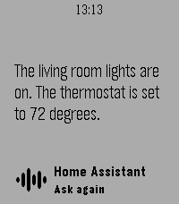
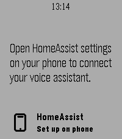

# HomeAssist

Speak to your Home Assistant voice assistant directly from Pebble Time 2.

Launching the configured app immediately opens Pebble dictation. The recognized text goes to your selected Home Assistant Assist pipeline, and its reply appears on your watch. Press SELECT to continue the conversation.

## Install

Build locally using the instructions below. Tagged builds will be available from [GitHub Releases](https://github.com/tylxr59/HomeAssist/releases) when published. This app is not yet listed in the Pebble Appstore.

## Features

- Immediate dictation on launch, with no transcript confirmation step.
- Selection of a named Home Assistant voice assistant.
- Scrollable text replies and conversation context until you exit.
- Visible connection, authentication, and assistant errors.

## Requirements

- Pebble Time 2 (`emery`) and a compatible Pebble phone companion with working dictation.
- A phone network connection that can reach your Home Assistant instance.
- Home Assistant with Assist pipelines configured and a long-lived access token permitted to list and run those pipelines.
- Pebble SDK 4.33.1 or compatible and Node.js 22+ to build and test locally.

Pebble's speech service performs transcription. The app sends the resulting text to HA's intent stage; it does not use HA's STT or TTS providers. Replies are text only. Select a pipeline whose language matches your Pebble dictation language.

## Screenshots




The reply screenshot uses sample text to preview the layout. Replies take the main reading area, with a compact assistant and voice indicator below. The watch UI keeps the system dictation palette, clock bar, and Gothic fonts. See [UI references](docs/ui-design.md).

## Setup

1. In your Home Assistant profile, create a **Long-Lived Access Token**. Treat it like a password.
2. Open HomeAssist's settings in the Pebble phone companion.
3. Enter your HA base URL (for example `https://home.example.com` or `http://192.168.1.20:8123`) and token, then tap **Connect**.
4. Wait for the connection result on the same page. Choose your voice assistant from the populated picker, then tap **Save**.
5. Launch HomeAssist on the watch and speak.

Connect keeps settings open and displays errors inline. Save closes the page and applies the selected assistant; the phone companion then validates the saved connection. Reopening existing settings automatically reconnects and preserves your assistant if it is still available. Changing URL or token requires reconnecting and selecting an assistant before saving. Cancelling the page leaves your saved configuration unchanged.

Use the base URL, without `/api/websocket`, query parameters, URL credentials, or a fragment. Path prefixes such as `https://example.com/homeassistant` are preserved. HTTP is supported for trusted local networks; HTTPS encrypts the connection. A local URL works only when the phone can reach that network (directly or through a VPN). Self-signed or untrusted certificates may be rejected by the companion.

Credentials and cached assistant metadata are stored in the phone's PebbleKitJS local storage and Clay settings storage. They are included in the bundled local settings page when you open it, never sent to the watch or a hosted configuration service, and never deliberately logged. Storage is not an encrypted credential vault. Clearing companion app data removes the configuration. Clear the URL/token and save to remove saved credentials from this app.

## Controls

- **Launch:** starts dictation once configured and the companion is ready.
- **SELECT:** starts another dictation, preserving the current conversation.
- **UP/DOWN:** scrolls the reply or setup/error text.
- **BACK:** closes dictation using the system controls, or exits the app from the result screen.

Exiting and reopening starts a fresh conversation. Saving settings also resets conversation context. Cancelling dictation submits nothing. Commands are sent immediately after recognition and may control devices without further confirmation. While processing, SELECT does not submit another command.

## Troubleshooting

- **Setup instructions:** enter URL/token, tap Connect, select an assistant, and save.
- **Authentication failed:** replace an invalid or revoked token, tap Connect, select an assistant, and save.
- **No assistants / permissions:** configure a voice assistant in HA and check that the token's user can list and run pipelines.
- **Assistant removed:** open settings, let it reconnect or tap Refresh assistants, then select an available assistant and save.
- **Dictation unavailable / failed:** check Bluetooth, companion dictation support, speech-service availability, and your phone's connection. The emulator cannot verify real speech recognition.
- **Connection failed:** test the base URL from your phone; check VPN, reverse-proxy WebSocket support, and certificates.
- **Timeout / lost connection / reply delivery failed:** a command may already have executed. Check HA before speaking it again. HomeAssist never automatically repeats an uncertain command.
- **Long messages:** transcripts over 1,024 UTF-8 bytes are rejected. Replies are limited to approximately 8 KB and visibly marked when truncated.

## Development

```bash
npm ci
npm test
npm run build
npm run install:emery
```

The install script launches the emulator with VNC. The PBW is `build/HomeAssist.pbw`. To install on a real watch, enable the phone companion's developer connection and run:

```bash
pebble install --phone PHONE_IP build/HomeAssist.pbw
```

Tests use mocked HA WebSockets and companion transports; no real HA credentials are needed. See [DEVELOPMENT.md](DEVELOPMENT.md) for the protocol and hardware acceptance checklist.

## Releases

A matching `v<package version>` tag builds and attaches the PBW to a [GitHub Release](https://github.com/tylxr59/HomeAssist/releases). Release notes come from that exact version's `CHANGELOG.md` entry. Ordinary commits and pull requests do not trigger publishing.

To repair an existing release: **Actions → Release PBW → Run workflow**, enter an existing tag. The workflow checks out that exact tag. New code requires a new version and tag. No release or tag is created by local builds.

## Project Layout

- `src/c/`: native watch UI and dictation.
- `src/pkjs/`: phone networking, Clay settings, and reply transfer.
- `test/`: HA, settings, and protocol tests.
- `docs/`: emulator screenshot.
- `package.json`, `wscript`: Pebble build configuration.
- `pebble-appstore.md`: proposed listing copy.

## License

[MIT](LICENSE).

## Notes

Inspired by [Home Assistant on your Wrist](https://github.com/caco3/pebble-home-assistant-on-your-wrist). HomeAssist uses a separate native C implementation focused on immediate dictation and named Assist pipelines. Implementation assisted by OpenAI Codex.
